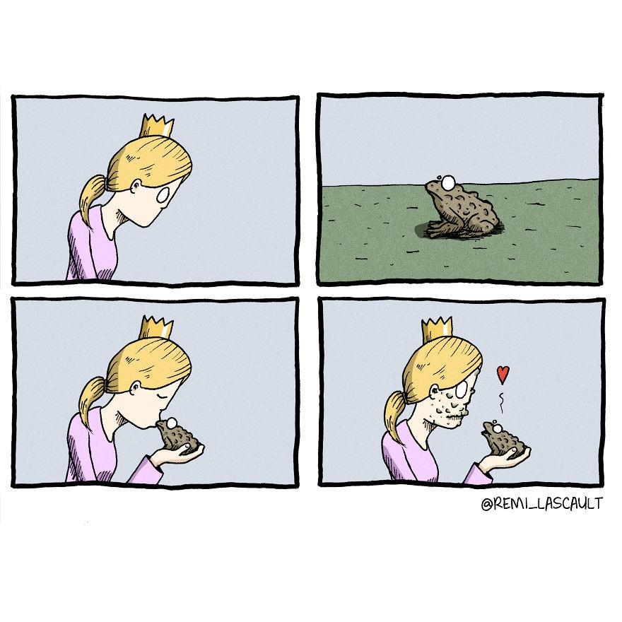

# Dataset

This directory contains the data construction pipeline for **TFQ-Data** and **TFQ-Bench** — the large-scale True-False Question dataset used to train and evaluate MetaphorStar.

## 📋 Table of Contents

- [Overview](#overview)
- [Source Data](#source-data)
- [Dataset Statistics](#dataset-statistics)
- [Generation Pipeline](#generation-pipeline)
- [Output Format](#output-format)
- [TFQ Construction (`construct_TFQ.py`)](#tfq-construction-construct_tfqpy)
- [Dataset Splits](#dataset-splits)

---

## Overview

TFQ-Data is constructed from high-quality metaphorical images sourced from [II-Bench](https://github.com/II-Bench/II-Bench). For each image, **GPT-4.1** is used in a two-stage pipeline to generate 5–10 True-False Question (TFQ) pairs covering both surface-level visual perception and deep metaphorical implications.

---

## Source Data

| Source | Images | Description |
| :----- | :----- | :---------- |
| [II-Bench](https://github.com/II-Bench/II-Bench) | 1,434 | High-quality metaphorical images (cartoons, ads, art, memes, etc.) with ground-truth explanations |

The input file `II-Bench.json` is a list of items, each containing:

```json
{
  "local_path": "path/to/image.jpg",
  "meta_data": {
    "explanation": "The image implies that modern society's obsession with social media erodes genuine human connection."
  }
}
```

---

## Dataset Statistics

| Split | Images | Questions |
| :---- | -----: | --------: |
| **TFQ-Data-Full** (training) | 1,384 | 13,607 |
| **TFQ-Data-Lite** (curated subset) | 100 | 984 |
| **TFQ-Bench-Full** (evaluation) | 1,434 | 14,099 |
| **TFQ-Bench-Lite** (evaluation subset) | 50 | 492 |

> TFQ-Bench-Lite is **strictly disjoint** from TFQ-Data-Full, ensuring rigorous out-of-distribution evaluation.

---

## Generation Pipeline

The construction follows a two-stage GPT-4.1 pipeline for each image:

```
┌─────────────────────────────────┐
│         Input Image             │
│      + II-Bench Metadata        │
└────────────┬────────────────────┘
             │
             ▼
┌─────────────────────────────────┐
│  Stage 1: Image Description     │
│  GPT-4.1 generates a detailed   │
│  paragraph describing the       │
│  image's visual elements        │
│  (roles, text, color, layout)   │
└────────────┬────────────────────┘
             │  image description
             ▼
┌─────────────────────────────────┐
│  Stage 2: TFQ Generation        │
│  GPT-4.1 generates 5–10 T/F     │
│  questions grounded in both     │
│  the visual description and     │
│  the ground-truth implication   │
└────────────┬────────────────────┘
             │
             ▼
┌─────────────────────────────────┐
│  Output: TFQ-Data JSON          │
│  { questions: [...],            │
│    answers: ["T","F",...] }     │
└─────────────────────────────────┘
```

### Design Principles

**Question coverage:**
- Each TFQ set probes the image across multiple dimensions — from basic visual information (similar to VQA) to deep metaphorical implications
- Hierarchical difficulty: easy perception-level questions through to complex multi-hop reasoning

**Answer quality:**
- `True` statements are clearly grounded in visual or contextual evidence
- `False` statements are crafted as **plausible distractors** that share surface-level similarity with the image but deviate from the correct interpretation

**Knowledge density:**
- 5–10 questions per image provides **3–5× denser supervision signal** compared to single-answer MCQ/OSQ formats — a key property enabling efficient RL training

### Example



**Ground-truth implication:** *(from II-Bench metadata)*
> The crown may symbolize traditional fairy tale themes, suggesting the girl represents a noble figure.

**Generated TFQ pairs:**

| # | Question | Answer |
|:--|:---------|:------:|
| 1 | The crown may symbolize traditional fairy tale themes, suggesting that the girl represents a noble figure. | **T** |
| 2 | The image implies that the girl is in a state of distress, as indicated by her facial expression. | **F** |
| 3 | The visual composition places emphasis on the crown as a central symbolic element. | **T** |

---

## Output Format

The construction script saves results to a JSON file with the following structure:

```json
[
  {
    "id": 0,
    "url": "path/to/image.jpg",
    "image_dep": "The image depicts a young girl wearing a golden crown...",
    "image_implication": "The crown may symbolize traditional fairy tale themes...",
    "True_false_questions": {
      "questions": [
        "The crown may symbolize traditional fairy tale themes, suggesting that the girl represents a noble figure.",
        "The image implies that the girl is in a state of distress, as indicated by her facial expression."
      ],
      "answers": ["T", "F"]
    }
  }
]
```

| Field | Description |
| :---- | :---------- |
| `id` | Sequential index (sorted by image number after completion) |
| `url` | Local path to the source image |
| `image_dep` | GPT-4.1 generated visual description (Stage 1 output) |
| `image_implication` | Ground-truth metaphorical implication from II-Bench metadata |
| `True_false_questions.questions` | List of 5–10 generated T/F question strings |
| `True_false_questions.answers` | Corresponding list of `"T"` or `"F"` labels |

---

## TFQ Construction (`construct_TFQ.py`)

### Setup

Configure your API credentials at the top of the script:

```python
API_KEY = "your_openai_api_key"
PROXY_API_URL = "your_api_endpoint"
MODEL_NAME = "gpt-4.1"          # Model used for both stages
```

Other configurable parameters:

```python
MAX_RETRIES = 3     # Retry attempts per API call on failure
RETRY_DELAY = 3     # Seconds to wait between retries
```

### Usage

1. Set the input and output paths in `main()`:

```python
INPUT_FILE  = 'dataset/II-Bench.json'
OUTPUT_FILE = 'dataset/train/TFQ_II-Bench.json'
```

2. Run:

```bash
python construct_TFQ.py
```

### Resumable Construction

The script automatically **resumes from where it stopped** if interrupted. Already-processed image paths are tracked in the output JSON; re-running will skip them and continue from the next unprocessed image — no duplicate API calls are made.

### Sorting & Reindexing

After all images are processed, results are automatically:
1. **Sorted** by image number (extracted from the filename/URL pattern `test-N`)
2. **Reindexed** so `id` fields form a clean `0, 1, 2, ...` sequence

### Sample Console Output

```
Loading data from dataset/II-Bench.json...
Loaded 850 existing results, will skip 850 processed URLs.
Total data: 1434, Unprocessed data: 584

Processing images: 100%|██████████| 584/584 [1:45:32<00:00, 10.85s/it]

All processing complete. Sorting and saving final results...
Processing complete! Total 1434 results sorted and saved to dataset/train/TFQ_II-Bench.json
```

---

## Dataset Splits

After construction, the full dataset (`TFQ_II-Bench.json`) is partitioned into training and evaluation sets:

| Split | Purpose | Images | Questions | Notes |
| :---- | :------- | -----: | --------: | :---- |
| **TFQ-Data-Full** | RL training | 1,384 | 13,607 | Full training set |
| **TFQ-Data-Lite** | Rapid experiment | 100 | 984 | Hand-curated for diversity and quality |
| **TFQ-Bench-Full** | Evaluation | 1,434 | 14,099 | Complete benchmark (includes all images) |
| **TFQ-Bench-Lite** | Efficient evaluation | 50 | 492 | Disjoint from TFQ-Data-Full |

*Note: For detailed training protocols using TFQ-Data, please refer to [train](../train/).*
*Note: For evaluation using TFQ-Bench, please refer to [evaluation](../evaluation/).*
