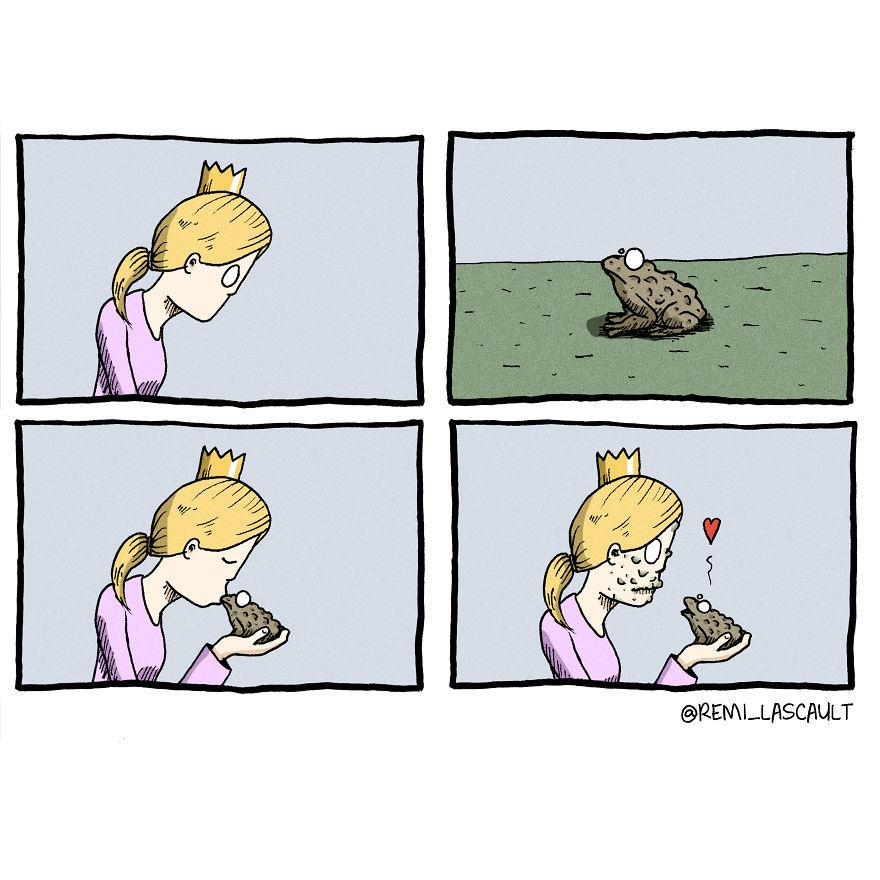

# Evaluation

This directory contains the evaluation scripts for the three complementary task formats used in MetaphorStar: **True-False Question (TFQ)**, **Multiple-Choice Question (MCQ)**, and **Open-Style Question (OSQ)**. Each format probes a distinct dimension of visual metaphor understanding, forming a comprehensive benchmark suite.

## 📋 Table of Contents

- [Task Formats Overview](#task-formats-overview)
- [Input Data Format](#input-data-format)
- [TFQ Evaluation (`eval_TFQ.py`)](#tfq-evaluation-eval_tfqpy)
- [MCQ Evaluation (`eval_MCQ.py`)](#mcq-evaluation-eval_mcqpy)
- [OSQ Evaluation (`eval_OSQ.py`)](#osq-evaluation-eval_osqpy)

---

## Task Formats Overview

| Format | Benchmark | Metric | Evaluator |
| :----- | :-------- | :----- | :-------- |
| **TFQ** | TFQ-Bench (1,434 images, 14,099 questions) | Image-level accuracy | Rule-based |
| **MCQ** | High-level Bench (50 images) | Question-level accuracy | Rule-based |
| **OSQ** | High-level Bench (50 images) | Average score (1–5) | GPT-4o |

---

## Input Data Format

All evaluation scripts expect a **JSON file** where each entry contains the following fields:

```json
[
  {
    "Question_ID": "img_001_q1",
    "Image_URL": "assets/Example_metaphor.png",
    "Question": "The crown may symbolize traditional fairy tale themes, suggesting that the girl represents a noble figure.",
    "Ground_Truth": "T",
    "Model_Output": "<think>The crown is a classic symbol in fairy tales associated with royalty and nobility, so this interpretation is grounded in visual evidence.</think><answer>T</answer>"
  }
]
```

| Field | Description |
| :---- | :---------- |
| `Question_ID` | Unique identifier for each question |
| `Image_URL` | Local path to the image file |
| `Question` | The question/statement presented to the model |
| `Ground_Truth` | The reference answer (`T`/`F` for TFQ, letter option for MCQ, free-form text for OSQ) |
| `Model_Output` | The raw output string generated by the model |

---

## TFQ Evaluation (`eval_TFQ.py`)

### Task Description

True-False Question (TFQ) requires models to judge whether each given statement about an image is **True** or **False**. Each image is accompanied by **5–10 statements** covering both surface-level visual perception and deep metaphorical implications. Models are expected to produce explicit Chain-of-Thought reasoning inside `<think>...</think>` tags before the final binary answer.

**Output format expected from model:**
```
<think> [step-by-step reasoning] </think> <answer> T </answer>
```
or equivalently `<answer> F </answer>`.

### Example



> **Question:** The crown may symbolize traditional fairy tale themes, suggesting that the girl represents a noble figure.
>
> **Ground Truth:** `T`
>
> **Model Output:** `<think>The crown is a classic symbol in fairy tales associated with royalty and nobility, so this interpretation is grounded in visual evidence.</think><answer>T</answer>`

### ⚠️ Key Evaluation Rule: Image-Level (Group-Level) Accuracy

> **TFQ is evaluated at the image level, NOT the question level.**
>
> **All questions belonging to the same image must be answered correctly for that image to be counted as correct.** For example, if an image has 10 TFQ questions, the model must answer all 10 correctly — answering 9/10 still counts the image as **incorrect**.

This strict image-level criterion is designed to ensure holistic understanding of an image's visual content and deeper metaphorical meaning, rather than rewarding partial guessing.

### Scoring Logic

The script groups all questions by `Image_URL`. For each group:

```
all_correct = all questions in this image answered correctly
```

The final reported metric is:

$$
\text{Image-level Accuracy} = \frac{\text{Number of fully-correct images}}{\text{Total number of images}}
$$

In addition, the script reports:

- **Question-level accuracy** — proportion of individual questions answered correctly (reference only)
- **Group statistics** — breakdown of fully-correct / partially-correct / fully-incorrect images
- **Empty answer count** — questions where no valid answer could be extracted

### Answer Extraction

The script tries the following patterns in order:

1. `<answer>T</answer>` or `<answer>F</answer>` (primary format)
2. `Answer: T` or `Answer: F`
3. Standalone `T` or `F` token (fallback)

### Usage

1. Set the path to your model output file in `main()`:

```python
file_path = 'evaluation/TFQ/eval_result.json'
```

2. Run:

```bash
python eval_TFQ.py
```

3. Results are printed to the console and saved to `eval_result_evaluation.txt` in the same directory.

### Sample Output

```
Group-level accuracy: 45.23% (649/1434)
Number of empty answers: 12/14099
Number of incorrect answers: 1843/14099

Group Level Statistics:
Total groups: 1434
Fully correct groups: 649
Partially correct groups: 612
Fully incorrect groups: 173
```

---

## MCQ Evaluation (`eval_MCQ.py`)

### Task Description

Multiple-Choice Question (MCQ) presents each image with the question *"What is the implication in this image?"* and **six candidate options (A–F)**, exactly one of which is correct. The model must select the best interpretation from a constrained set of choices. This format provides a stable, medium-difficulty evaluation of discriminative visual reasoning.

**Output format expected from model:**
```
<think> [reasoning] </think> <answer> B </answer>
```

### Scoring Logic

Each question is scored independently:

$$
\text{Accuracy} = \frac{\text{Number of correctly answered questions}}{\text{Total number of questions}}
$$

The script also computes image-level group accuracy (all questions per image correct), though for MCQ benchmarks each image typically has one question.

### Answer Extraction

The script tries the following patterns in order:

1. `<answer>X</answer>` where `X` is a letter A–Z
2. `Answer: X`

### Usage

1. Set the path to your model output file in `main()`:

```python
file_path = 'evaluation/MCQ/eval_result.json'
```

2. Run:

```bash
python eval_MCQ.py
```

3. Results are printed to the console and saved to `eval_result_evaluation.txt` in the same directory.

### Sample Output

```
Individual pass@1 accuracy: 72.00% (36/50)
Number of empty answers: 0/50
Number of incorrect answers: 14/50
```

---

## OSQ Evaluation (`eval_OSQ.py`)

### Task Description

Open-Style Question (OSQ) requires models to generate **free-form responses** to *"What is the implication in this image?"* without any pre-defined answer constraints. This format represents the upper bound of task difficulty and evaluates comprehensive generation-based interpretation capabilities.

Model outputs are scored by **GPT-4o** using a 5-dimensional rubric aligned with human judgement (98.7% human-GPT agreement).

### Scoring Rubric (1–5 points)

| Score | Criteria |
| :---- | :------- |
| **5** | Accurately captures all visual elements; profoundly identifies emotion, domain, and rhetorical devices; highly consistent with reference answer; demonstrates deep cultural understanding |
| **4** | Accurately captures elements; clearly identifies emotion/domain/rhetoric; relatively deep metaphor mining; minor gaps in detail |
| **3** | Captures elements relatively well; preliminary emotion/rhetoric identification; some relevance to implied meaning; room for improvement |
| **2** | Partially captures elements; vague emotion/rhetoric identification; clear deficiency in depth |
| **1** | Fails to capture important elements; no emotional/rhetorical insight; surface-level only |

### Five Evaluation Dimensions

The rubric evaluates across five complementary dimensions:

1. **Surface-level Information** — accuracy of visual element description
2. **Emotional Expression** — identification of emotional tone and attitude
3. **Domain and Context** — cultural/contextual background awareness
4. **Rhetorical Skills** — recognition of metaphor, irony, hyperbole, etc.
5. **Deep Implications** — understanding of the core intended meaning

### Setup

Before running, configure your API credentials in the script:

```python
api_key = "your_openai_api_key"
proxy_api_url = "your_api_endpoint"
```

The script supports both **English** (`language='en'`) and **Chinese** (`language='zh'`) datasets.

### Usage

1. Set paths and language in `main()`:

```python
input_path = 'evaluation/OSQ/eval_result.json'
output_score_path = 'evaluation/OSQ/eval_result_score.json'
output_summary_path = 'evaluation/OSQ/eval_result_summary.txt'
language = 'en'   # or 'zh'
```

2. Run:

```bash
python eval_OSQ.py
```

3. Per-image scores are saved to `eval_result_score.json`; the aggregate summary is saved to `eval_result_summary.txt`.

### Resumable Evaluation

The script automatically **resumes from where it stopped** if interrupted. Already-processed image URLs are tracked, so re-running the script will skip previously evaluated images without incurring extra API costs.

### Sample Output

```
Starting OSQ evaluation...
Processing images: 100%|██████████| 50/50 [03:12<00:00,  3.84s/it]

Calculating average score...
Overall average score: 3.74, total 50 instances
```

---

## Metric Summary

| Task | Primary Metric | Notes |
| :--- | :------------- | :---- |
| **TFQ** | **Image-level accuracy** | **All questions per image must be correct; partial credit is NOT given** |
| **MCQ** | Question-level accuracy (pass@1) | One question per image on High-level Bench |
| **OSQ** | Average GPT-4o score (1–5) | Requires API key; supports resume |
